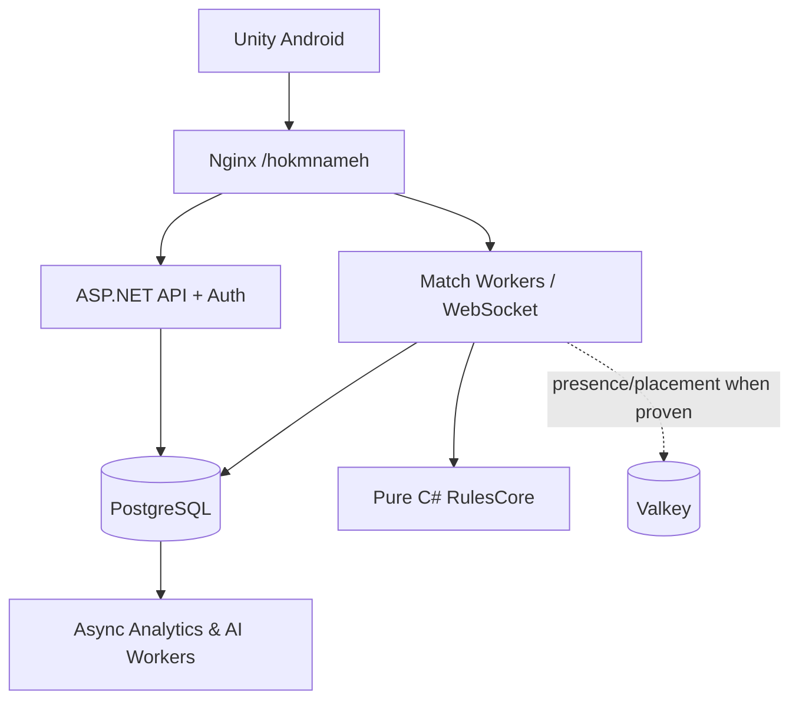
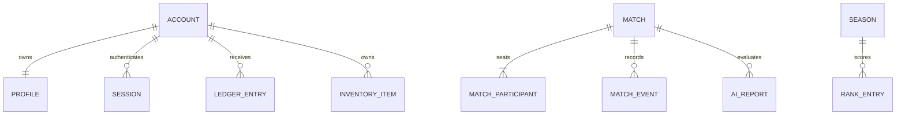

# پروپوزال مهندسی بازی «حکمنامه»

**Slug:** `hokmnameh`  
**نسخه:** 3.1 — ۱۴۰۵/۰۸/۳۰ (2026-11-21)  
**مخزن سورس:** `ostaddehdari/hokmnameh`  
**مرکز کنترل:** `ostaddehdari/deployment-center/projects/hokmnameh/`

## 1. دفتر شواهد و وضعیت واقعی

این سند از گفت‌وگوی حاضر و تصمیم‌های قابل‌دسترسی ChatGPT Project، مخزن GitHub، `README.md`، معماری، API، برنامه ۲۳۹ تسکی، تصمیم‌های باز و گزارش اجرای S01 تهیه شده است. سند مادر خصوصی که مستقیماً بازیابی نشده، منبع خوانده‌شده تلقی نمی‌شود.

### تصمیم‌های قطعی

- محصول، بازی حکم چهار‌نفره فارسی برای Android با Unity 6 است؛ هسته قواعد Pure C# میان Unity و سرور مشترک می‌ماند.
- بک‌اند ASP.NET Core و PostgreSQL است؛ سرور آنلاین authoritative و کلاینت مرجع نتیجه نیست.
- آکادمی/تمرین، آزاد، رنک و تورنمنت اسپانسری چهار دامنه اصلی‌اند؛ «حکم آرنا» Ruleset مستقل فاز دوم است.
- ورود آزاد و رنک رایگان و نامحدود است؛ سکه هزینه ورود یا منبع برتری رقابتی نیست؛ VIP و Pay-to-Win ممنوع‌اند.
- تمرین با ربات فقط XP می‌دهد و منبع تکرارشونده سکه نیست. ترک بازی با جایگزینی ربات و ضمانت دادرسی برای جریمه مدیریت می‌شود.
- رنک Solo و Duo را می‌پذیرد و اولویت با مسابقه هم‌نوع است؛ فصل سه‌ماهه و شش لیگ برنامه‌ریزی شده‌اند.
- ارتباط داخل مسابقه فقط پیام/ایموت ازپیش‌تأییدشده است. اطلاعات دست، Seed و تحلیل زنده نباید نشت کند.
- AI-01 تحلیل تصمیم را فقط بر اساس Information Set قانونی و به‌صورت ex-ante انجام می‌دهد؛ گزارش پس از مسابقه است و MMR از امتیاز تحلیلی جدا می‌ماند.
- مقصد اعلام‌شده بک‌اند `https://srun.ir/hokmnameh` است. Swagger UI و OpenAPI باید زیر همین base path در دسترس باشند.

### واقعیت فنی فعلی

- v0.1 شامل هسته قواعد، API هویت مهمان، اتاق تمرین/آزاد، WebSocket یک‌طرفه، PostgreSQL، نمونه Unity/LAN، Docker و Nginx snippet است.
- CI اجرای 44692067992 برای build، smoke، migration idempotency و Docker سبز ثبت شده است.
- S01 در سورس «پیاده‌سازی‌شده/جزئی» است، اما استقرار VPS، rollback واقعی، restore خارج‌میزبان، alerting و route عمومی هنوز evidence ندارد.
- اتاق‌ها in-memory هستند؛ ranked، اقتصاد، SMS، event log پایدار، reconnect مقاوم، UX نهایی و AI-01 هنوز آماده تولید نیستند.
- Swagger در SHA مبنای `0867050...` فعال نیست و نشانی عمومی نباید تا تست HTTP واقعی «فعال» گزارش شود.

### تصمیم‌های باز بحرانی

- قواعد نهایی حاکم، کُت/سور، گردش حاکم، Cut، جهت پخش، deadline و fallback باید تصویب و versioned شوند.
- برنامه جدید E-04 توزیع `5+4+4` را می‌خواهد، ولی Ruleset فعلی و کد v0.1 هنوز `5+8` هستند؛ Ranked تا رفع تعارض مجاز نیست.
- ظرفیت هدف، SLO، RPO/RTO، ارائه‌دهنده SMS، سیاست حریم خصوصی، بودجه عملیات و سیاست جوایز نقدی/اسپانسری نیازمند تصویب‌اند.

## 2. مسئله، هدف و KPI

بازار به یک حکم آنلاین منصفانه، سریع و قابل اعتماد نیاز دارد که هویت فرهنگی ایرانی، بازی LAN بدون اینترنت، رقابت Solo/Duo، مسیر پیشرفت سالم و درآمدزایی غیر Pay-to-Win را یکپارچه کند.

| هدف | سنجه پذیرش |
|---|---|
| مسابقه کلاسیک منصفانه | 100٪ فرمان‌ها توسط سرور validate؛ صفر نشت دست در contract/security tests |
| شروع ساده | ساخت مهمان تا ورود به تمرین با حداکثر 3 اقدام اصلی در UX نهایی |
| پایداری بتای بسته | crash-free session و reconnect با اهدافی که پیش از بتا عددگذاری و اندازه‌گیری می‌شوند |
| سلامت اقتصاد | صفر سکه از تمرین تکرارشونده؛ تمام تغییر موجودی double-entry و idempotent |
| عدالت رنک | گزارش نرخ Solo/Duo/Mixed، RTT و زمان انتظار؛ Mixed فقط طبق policy نسخه‌دار |
| قابلیت عملیات | health، metrics، backup، restore drill و rollback واقعی با evidence |
| تحلیل مهارت | گزارش ex-ante بعد مسابقه با confidence و نسخه مدل؛ بدون راهنمای زنده در Ranked |

## 3. بازیگران و جریان‌های اصلی

بازیکن مهمان/ثبت‌شده، بازیکن رنک، بازیکن Duo، مدیر تورنمنت، اسپانسر، ناظر ایمنی/اعتراض، پشتیبان و اپراتور سامانه بازیگران اصلی‌اند. مسیر MVP: اجرای برنامه → مهمان → آکادمی یا اتاق آزاد → انتخاب حکم → بازی 13 تریک → نتیجه/XP → بازگشت به لابی. مسیر بتا: ارتقای حساب با موبایل → صف Solo/Duo → Ready Check → مسابقه durable → نتیجه/رنک → بازپخش و گزارش.

## 4. مرز محصول

**MVP مهندسی:** Ruleset کلاسیک مصوب، تمرین با سه ربات، اتاق آزاد چهار نفره، reconnect پایه، event log پایدار، هویت مهمان و ارتقای موبایل، UX فارسی، Swagger/OpenAPI، telemetry، CI/CD امن و استقرار آزمایشی.

**پس از MVP:** رنک/فصل/لیگ، اقتصاد cosmetic، میراث پادشاهان، تورنمنت اسپانسری، باشگاه و moderation، AI-01/ISMCTS، مقیاس افقی و لانچ Android.

**فاز دوم:** Hokm Arena، گسترش روایت/باشگاه و قابلیت‌های آزمایشی مستقل. شرط‌بندی، فروش قدرت رقابتی، چت آزاد داخل مسابقه، رتبه معتبر از LAN آفلاین و راهنمای زنده AI در Ranked خارج از Scope هستند.

## 5. الزامات قابل آزمون

### قرارداد وضعیت تصمیم الزام‌ها

رجیستری ساختاریافته در `proposal.json` برای **تمام** الزام‌های FR/NFR/SEC/DATA/OPS دارای `id`، تاریخ `recorded_at`، آرایه `source_refs` و یکی از وضعیت‌های زیر است:

- `Approved`: تصمیم در شواهد قابل‌دسترسی Project صریحاً تأیید شده است.
- `Assumed`: فرض مهندسی قابل‌آزمون است و پیش از تولید باید اعتبارسنجی شود.
- `Pending`: تصمیم مالک محصول/عملیات لازم است و تا تصویب، استفاده تولیدی مسدود می‌ماند.

این وضعیت با اولویت Must/Should/Could متفاوت است و هیچ فرضی را به تصمیم قطعی تبدیل نمی‌کند.

| ID | اولویت | الزام و معیار پذیرش |
|---|---|---|
| FR-001 | Must | Ruleset کلاسیک versioned؛ Golden fixtures برای deal، follow-suit، trump، trick، score و پایان بازی پاس شوند. |
| FR-002 | Must | Shuffle/Cut/Deal طبق نسخه مصوب E-04؛ commit پیش از deal، replay قطعی و independence از MMR/پرداخت اثبات شود. |
| FR-003 | Must | مهمان و ارتقای موبایل با session rotation/revocation؛ duplicate OTP و abuse rate-limit کنترل شود. |
| FR-004 | Must | تمرین 1+3 bot؛ فقط XP idempotent و سکه تکرارشونده صفر باشد. |
| FR-005 | Must | اتاق آزاد چهار نفره با invite code، Ready، فرمان idempotent، disconnect/rejoin و bot replacement. |
| FR-006 | Must | state هر seat فقط hand خود و داده عمومی را برگرداند؛ تست adversarial نشت صفر. |
| FR-007 | Must | صف Ranked Solo/Duo با اولویت هم‌نوع، Ready چهار انسان و reservation اتمیک. |
| FR-008 | Must | فصل سه‌ماهه/شش لیگ؛ MMR ledger auditپذیر و نتیجه مسابقه idempotent. |
| FR-009 | Must | ترک/AFK با evidence، escalation، appeal و bot completion؛ قطع شبکه کورکورانه «عمدی» محسوب نشود. |
| FR-010 | Must | Economy double-entry؛ free/ranked entry cost=0، practice coins=0، cosmetics بدون اثر گیم‌پلی. |
| FR-011 | Should | کارت شانس از بازی مشروع شارژ شود؛ claim محدود/شفاف و جوایز cosmetic مدت‌دار یا مقدار محدود سکه. |
| FR-012 | Should | Royal Legacy: قطعه یکتا از برد واجد شرایط رنک، Focus قفل‌شده و Claim/Outbox قابل بازیابی. |
| FR-013 | Should | تورنمنت اسپانسری، skin/arena تبلیغاتی و impression audit بدون دست‌کاری RNG/MMR. |
| FR-014 | Must | پیام‌های preset داخل بازی؛ moderation، گزارش و appeal برای ارتباطات خارج بازی. |
| FR-015 | Should | AI-01: انتخاب حکم، کیفیت کارت، سوزاندن، همکاری، timing، memory، luck/skill و win probability با CI. |
| FR-016 | Should | ربات پنج‌سطحی و ربات جایگزین؛ سطح قوی‌تر از Information Set قانونی و بدون omniscience. |
| FR-017 | Must | LAN چهار دستگاه بدون اینترنت؛ هیچ Rank/paid currency معتبر از LAN تولید نشود. |
| FR-018 | Must | Swagger UI و OpenAPI نسخه‌دار برای تمام APIها در `/hokmnameh/swagger` و `/hokmnameh/swagger/v1/swagger.json`. |
| FR-019 | Must | صفحه‌های Unity فارسی/RTL، responsive روی ابعاد هدف و میز کم‌حواس‌پرتی با دسترسی‌پذیری پایه. |
| FR-020 | Must | مدیریت نسخه، feature flag و kill switch برای اقتصاد، تبلیغات، Ranked و Arena. |

| ID | اولویت | الزام غیرفنی و معیار پذیرش |
|---|---|---|
| NFR-001 | Must | اهداف latency/CCU فقط پس از load baseline تصویب؛ تست‌های 100/500/1000/4000 کلاینت مصنوعی جداگانه گزارش شوند. |
| NFR-002 | Must | API/DB فقط private/localhost؛ TLS روی gateway؛ هیچ secret یا DB واقعی در Git. |
| NFR-003 | Must | تمام timestamps UTC، Persian presentation در client، pagination محدود و خطاهای typed. |
| NFR-004 | Must | Accessibility: کنتراست، اندازه متن، reduced motion، non-color cues و safe-area موبایل. |
| NFR-005 | Must | structured logs/metrics/traces با redaction؛ dashboard برای WS، turn p95، DB pool، queue و economy. |
| SEC-001 | Must | object-level authorization، bearer rotation، rate limit، CORS محدود، security headers و dependency/SAST scans. |
| SEC-002 | Must | RNG seed، hand دیگران، OTP، token و PII در log/analytics/client payload ممنوع. |
| SEC-003 | Must | threat model برای cheating، replay، duplicate reward، queue manipulation، collusion و admin abuse. |
| DATA-001 | Must | PostgreSQL source of truth؛ migration versioned/checksummed/locked و rollback/backfill plan. |
| DATA-002 | Must | Match/Command/Event/Reward ledgers append-only یا auditپذیر با idempotency keys و optimistic concurrency. |
| OPS-001 | Must | dev/staging/prod جدا، health live/ready، backup encrypted، off-host copy و restore drill واقعی. |
| OPS-002 | Must | release immutable، preflight، Nginx backup، `nginx -t`، canary/health و rollback قابل اندازه‌گیری. |
| OPS-003 | Must | CI: format → lint/static → build → unit → integration/migration → security scan → image → review. |

## 6. معماری منطقی و ADR

- **ADR-001:** Monorepo و RulesCore مشترک Pure C# حفظ می‌شود؛ Unity dependency وارد Core نمی‌شود.
- **ADR-002:** Modular service boundaries درون .NET تا وقتی load evidence نیاز به جداسازی را ثابت کند؛ worker مسابقه single-writer است.
- **ADR-003:** PostgreSQL حقیقت پایدار؛ Valkey فقط برای presence/lease/placement پس از نیاز اثبات‌شده.
- **ADR-004:** HTTP command + WebSocket state/event push؛ commandها idempotent و state versioned.
- **ADR-005:** AI worker آفلاین از event stream قانونی؛ LLM در حلقه هر حرکت ممنوع.

ماژول‌ها: Identity، Profile، Rules/Match، Room/Realtime، Matchmaking/Rank، Economy/Inventory، Royal Legacy، Tournament/Sponsor، Social/Safety، Analytics/AI، Admin/Operations.

## 7. طراحی داده

تمام entityها UUID، `created_at` UTC و constraint دامنه دارند. MatchEvent دارای `match_id, sequence, action_id, actor_seat, type, payload_version, state_version, occurred_at` و unique `(match_id,sequence)`/`action_id` است. LedgerEntry append-only و دارای correlation/idempotency unique است. داده OTP/token فقط hash می‌شود؛ retention برای session، audit، chat report و AI feature باید پیش از production تصویب شود. Indexها از query pattern و `EXPLAIN` می‌آیند، نه حدس. حذف حساب با anonymization/retention قانونی و تفکیک audit انجام می‌شود.

## 8. قرارداد API

API با `/hokmnameh/api/v1` version می‌شود. OpenAPI منبع قرارداد و Swagger صرفاً UI آن است. endpointهای فعلی identity/rooms/trump/play/health حفظ و با ProblemDetails، validation، operationId، auth scheme و نمونه‌ها تکمیل می‌شوند. فرمان‌های state-changing از `Idempotency-Key` و `If-Match/stateVersion` استفاده می‌کنند؛ listها cursor pagination و limit سقف‌دار دارند. WebSocket با reconnect token و sequence resume تکمیل می‌شود. 400 validation/rule، 401 auth، 403 object access، 404، 409 conflict/version، 422 domain، 429 و 503 استاندارد می‌شوند.

## 9. امنیت و حریم خصوصی

مرزهای اعتماد: دستگاه، اینترنت/gateway، API، worker، DB/Valkey، operator و analytics. تهدیدهای اصلی cheating client، hidden-information leak، replay/duplicate command، reward double-spend، credential stuffing/OTP abuse، queue manipulation/collusion، sponsor fraud و admin misuse هستند. کنترل‌ها: authoritative server، least privilege، per-object auth، nonce/idempotency، optimistic concurrency، rate limits، seed commitment/reveal policy، encrypted transit/backups، secret rotation، audit admin، dependency pin/scan و redacted telemetry. OWASP ASVS/Top 10 چک‌لیست کیفیت است نه ادعای گواهی.

## 10. UX/UI

رابط فارسی RTL، کم‌تصمیم و mobile-first است. میز تمام‌صفحه با زاویه ثابت، نمایش حداقلی، safe area، دست‌های قابل خواندن، بازخورد turn/deadline و عدم استفاده از نور/رنگ به‌تنهایی طراحی می‌شود. آکادمی سطح ربات را قبل بازی می‌گیرد؛ نتیجه تمرین XP و پیشرفت آموزشی را شفاف نشان می‌دهد. خرید/تبلیغ/پاداش هرگز وسط تصمیم رقابتی مزاحم نمی‌شود.

## 11. کیفیت، تست و تحویل

قالب/آنالیز C#، build warnings policy، unit/property/golden rules، integration DB، contract OpenAPI، E2E چهار کلاینت، device/LAN، reconnect/chaos، load، security و restore/rollback الزامی‌اند. Branch کوتاه‌عمر + PR + CODEOWNERS؛ تغییر Ruleset/اقتصاد/security دو بازبین حوزه‌ای می‌خواهد.

Definition of Done: کد و migration review شده، تست مرتبط PASS، API/docs به‌روز، threat/telemetry بررسی، no-secret scan، artifact immutable، rollback مشخص، acceptance evidence با SHA واقعی و وضعیت central state ثبت شده باشد.

## 12. استقرار

هدف اعلام‌شده `https://srun.ir/hokmnameh` روی Ubuntu/Nginx است. API و PostgreSQL عمومی نمی‌شوند. مسیرهای هدف: UI/API base `/hokmnameh`، Swagger `/hokmnameh/swagger`، JSON `/hokmnameh/swagger/v1/swagger.json` و healthها زیر base path. هیچ ادعایی درباره فعال‌بودن route، TLS، backup یا Swagger بدون curl و evidence سرور پذیرفته نیست.

## 13. ریسک‌ها

تعارض 5+8 و 5+4+4، تغییر قواعد قبل freeze، in-memory match loss، نبود test device، دسترسی استقرار، هزینه Unity/art، تقلب/collusion، تورم اقتصاد، محدودیت SMS، moderation فارسی، latency ایران و پیچیدگی زودهنگام AI/scale ریسک‌های اصلی‌اند. هرکدام در Stage مربوطه با gate و rollback کنترل می‌شوند.

## 14. نقشه استیج سطح بالا

S00 تثبیت محصول و قوانین؛ S01 زیرساخت/CI/VPS/Swagger؛ S02 هسته و عدالت؛ S03 هویت/آموزش؛ S04 سرور durable/reconnect؛ S05 LAN/bots؛ S06 UX نهایی؛ S07 Ranked؛ S08 Economy/Royal؛ S09 Social/Safety؛ S10 Sponsor/Tournament؛ S11 AI/Coach؛ S12 Security/Scale/Observability؛ S13 Beta/Android release؛ S14 Arena.

ردگیری جزئی Requirements→Tasks→Tests→Artifacts در `deployment-center/projects/hokmnameh/plan.json` نگهداری می‌شود. گزارش پیشرفت باید فقط از commit/test/log واقعی مشتق شود.
